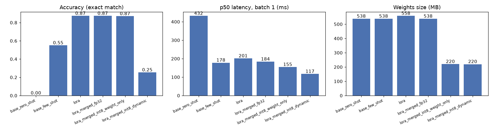

# lora-serve

LoRA fine-tune a 135M open model on CPU for news topic classification, quantize it to int8, and serve it with FastAPI.

## Why

Prompting a small model is cheap to try but often unreliable. This repo measures that against
a LoRA fine-tune on a real dataset with an exact-match score, then takes the fine-tuned model
through the steps you need to actually run it: merge, quantize, serve behind guardrails, track
experiments, expose metrics, test in CI.

## Quickstart

```bash
python -m venv .venv && source .venv/bin/activate
make install                      # CPU torch + package with ml and dev extras
pytest -q                         # offline, a few seconds

python -m lora_serve.train        # LoRA SFT, ~7 min on 8 CPU cores
python -m lora_serve.evaluate     # writes results/results.json
python scripts/plot_results.py    # writes results/comparison.png
python -m lora_serve.export       # merged model in artifacts/merged

PREDICTOR=hf uvicorn lora_serve.app:app --port 8000
curl -s localhost:8000/predict -H 'content-type: application/json' \
  -d '{"text": "Apple shares rose 4% after record iPhone sales."}'
# {"label":"Business","attempts":1,"model":"merged-int8","latency_ms":186.3}
```

Docker (expects the merged model from `make export` in `artifacts/merged`):

```bash
docker build -t lora-serve .
docker run -p 8000:8000 -v $PWD/artifacts:/app/artifacts lora-serve
```

MLflow runs: `mlflow ui --backend-store-uri sqlite:///mlflow.db`

## Results

Task: [AG News](https://huggingface.co/datasets/fancyzhx/ag_news), 4 topics, answer must be
`{"label": "..."}`. Model: `HuggingFaceTB/SmolLM2-135M-Instruct`. 1,200 training articles,
300 test articles (seed 0), greedy decoding, 8 CPU threads. Invalid JSON counts as wrong.

| variant | accuracy | valid JSON | p50 latency (ms, batch 1) | weights (MB) |
|---|---|---|---|---|
| base, zero-shot | 0.000 | 0.000 | 432 | 538 |
| base, 4-shot prompt | 0.550 | 0.893 | 178 | 538 |
| LoRA adapter | 0.873 | 1.000 | 201 | 558 |
| LoRA merged, fp32 | 0.873 | 1.000 | 184 | 538 |
| LoRA merged, int8 weight-only | **0.870** | 1.000 | 155 | **220** |
| LoRA merged, int8 dynamic (torch) | 0.253 | 0.357 | 117 | 220 |

Training: 150 steps, 4.9M of 139M parameters trainable (3.5%), 397 s wall time, final
batch loss 0.055. Raw numbers are in [results/results.json](results/results.json).



What this shows:

- Zero-shot the base model never produces the required JSON (it chats, echoes the template or
  invents keys). Four examples in the prompt get it to 55%.
- LoRA on 1,200 examples gets 87% with 100% valid JSON, using a shorter prompt than few-shot.
- Weight-only int8 cuts size by 59% for a 0.3 point accuracy drop. Full dynamic int8
  (activations too) is faster but breaks this small model, so it is not used for serving.

## How it works

- `lora_serve/task.py` holds the prompt, few-shot examples and the JSON schema. Evaluation and
  serving parse output the same way.
- `lora_serve/train.py` wraps the model with peft LoRA (r=16 on attention and MLP projections)
  and trains with a plain PyTorch loop. Prompt tokens are masked so loss only covers the answer.
  Params and per-step loss go to MLflow.
- `lora_serve/evaluate.py` runs every variant on the same split and logs one MLflow run each.
- `lora_serve/modeling.py` has the weight-only int8 layer (int8 weights, per-row scale).
- `lora_serve/app.py` is the API:
  - `POST /predict`: input guardrails (length 3 to 2000 chars, prompt-injection patterns) ->
    model -> JSON schema check -> one retry with a few-shot prompt if invalid -> 502 if still
    invalid. Blocked input returns 422.
  - `GET /health`
  - `GET /metrics`: Prometheus counters for requests by status, guardrail blocks by reason,
    schema retries, predicted labels, and a latency histogram.

Why not RAG here: the label depends only on the text in the request, so there is nothing to
retrieve. See [DESIGN.md](DESIGN.md) for the fine-tuning vs prompting vs RAG notes.

## Layout

```
lora_serve/
  task.py         prompt, labels, output schema, parser
  data.py         AG News loading and seeded splits
  modeling.py     load, decode, int8 quantization, size helper
  train.py        LoRA SFT loop + MLflow
  evaluate.py     variant comparison + MLflow
  export.py       merge adapter into base weights
  guardrails.py   input checks
  predictor.py    fake and HF predictors, schema retry
  app.py          FastAPI app and Prometheus metrics
scripts/plot_results.py
results/          results.json, comparison.png
tests/            offline unit tests (fake predictor, tiny random Llama)
Dockerfile, Makefile, .github/workflows/ci.yml, AGENTS.md, DESIGN.md
```

## Limitations

- One run, one seed, 300 test articles. Accuracy differences under ~4 points are within noise.
- Latency was measured on a shared 8-core CPU box with other processes running; treat it as
  relative, not absolute. p95 for merged fp32 had a large outlier (643 ms).
- No GPU, so QLoRA proper (4-bit base via bitsandbytes) was not run; LoRA is on an fp32 base
  and quantization happens after merging.
- The Docker image was written but not built or run in this environment (no Docker available).
  The service itself was run with uvicorn against the merged int8 model.
- Prompt-injection checks are regex based. They catch common phrasings, not paraphrases, and
  the model output is still schema-checked as the real safety net.
- The weight-only int8 layer dequantizes on every forward; a fused int8 kernel would be faster.
- Weights, adapters and MLflow data are not committed. Rerun `train` to reproduce.

## License

MIT
